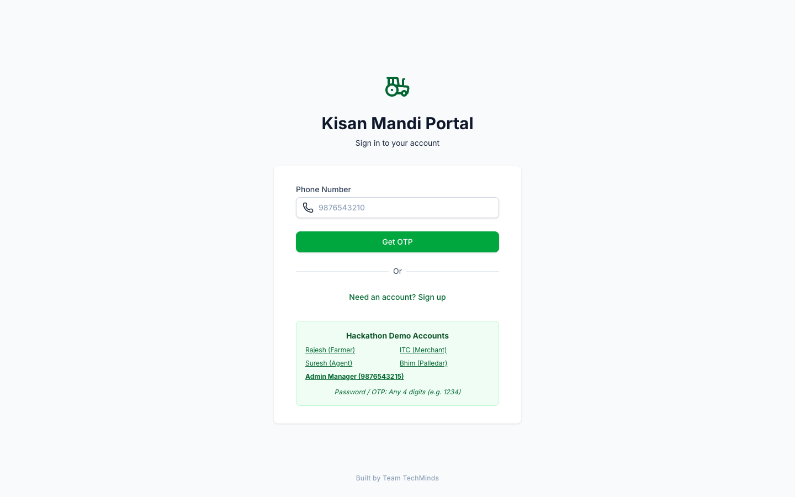
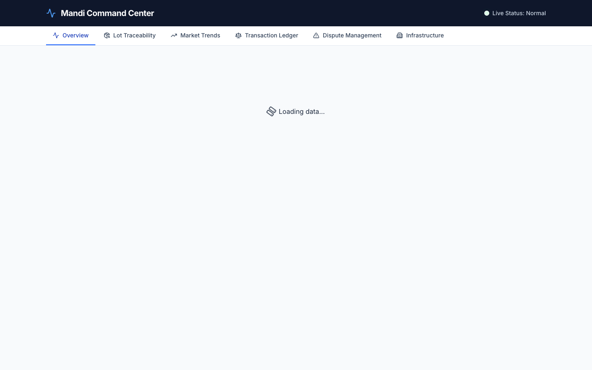
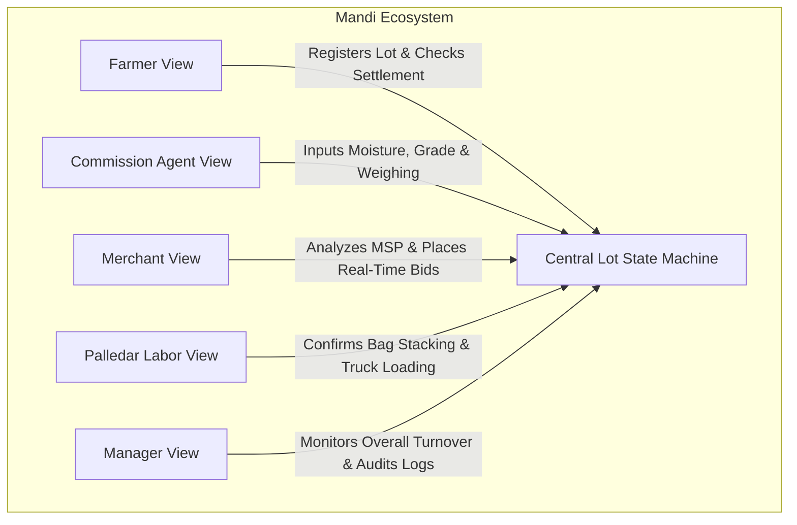

# Kisan Mandi MVP

[](https://github.com/Kartik-idk/Kisan-Mandi-mvp/actions)
[](https://www.typescriptlang.org/)
[](https://nextjs.org/)
[](https://tailwindcss.com/)
[](https://kisan-mandi-mvp.vercel.app)

> A role-based digital agricultural mandi workflow platform modeling crop lot traceability, real-time auction bidding, and transparent settlement.

[**Explore Live Prototype Demo**](https://kisan-mandi-mvp.vercel.app)

---

## Application Interface

| Mandi Role Portal | Manager Lot Traceability |
| :---: | :---: |
|  |  |
| *Role selector: Farmer, Agent, Merchant, Palledar, and Manager* | *Centralized management view auditing live lot progress and settlements* |

---

## Problem Statement

Wholesale agricultural mandis in India manage critical food supply chains, yet daily transactions often suffer from:
1. **Asymmetric Information:** Farmers lack real-time visibility into live bidding and current market clearing prices versus government Minimum Support Prices (MSP).
2. **Fragmented Workflows:** Intake weighing, quality assessment, auction bids, and dispatch labor are maintained across disconnected paper ledgers.
3. **Dispute Vulnerabilities:** Unrecorded discrepancies between gate arrival weights and merchant dispatch quantities lead to delayed payments and contractor friction.

**Kisan Mandi MVP** unifies these disjointed market interactions into a single, role-based real-time state machine where every stakeholder accesses a tailored lens of the identical lot lifecycle.

---

## Lot Lifecycle & Role-Based Architecture

Agricultural lots progress through a strictly ordered five-stage state machine:

```mermaid
stateDiagram-v2
    [*] --> ARRIVED: Farmer registers lot at gate
    ARRIVED --> WEIGHED: Commission Agent records net weight & moisture
    WEIGHED --> AUCTIONED: Merchants submit competitive bids; highest bid locked
    AUCTIONED --> SETTLED: Payment confirmed with MSP benchmark verification
    SETTLED --> DISPATCHED: Palledars record bag count & truck departure
    DISPATCHED --> [*]
```



### Specialized Stakeholder Perspectives



- **Farmer View:** Register crop varieties, inspect verified weights, monitor live auction increments, and confirm payment clearance.
- **Commission Agent (Kaccha Aadhat):** Facilitate physical intake, record quality grading (moisture content, impurities), and open lots for auction.
- **Merchant (Pakka Aadhat):** Evaluate crop quality certificates, submit real-time bids subject to validation constraints, and compare winning bids against historical mandi averages.
- **Palledar Crew:** Log labor operations, confirm physical bag tally counts, and mark lots as ready for transport.
- **Mandi Administrator:** Comprehensive audit oversight across all participants, tracking daily volume, settlement velocity, and dispute flags.

---

## Technology Stack

| Layer | Technologies |
| :--- | :--- |
| **Framework & Language** | Next.js 15, TypeScript 5, React 19 |
| **Styling & Components** | Tailwind CSS, Lucide React Icons |
| **Data & State Management** | Supabase (PostgreSQL, Realtime Subscriptions) |
| **Visualization & Charts** | Recharts (MSP benchmarks, historical price trends) |
| **Code Quality & CI** | ESLint 9, TypeScript Strict Checking, GitHub Actions |
| **Deployment** | Vercel (Edge-optimized production builds) |

---

## Local Development & Setup

### Prerequisites

- Node.js 20+ installed
- npm 10+ installed
- A Supabase project (or local Supabase CLI instance)

### Installation

1. **Clone repository:**
   ```bash
   git clone https://github.com/Kartik-idk/Kisan-Mandi-mvp.git
   cd Kisan-Mandi-mvp
   ```

2. **Install dependencies:**
   ```bash
   npm ci
   ```

3. **Configure environment variables:**
   Create `.env.local` in the project root:
   ```env
   NEXT_PUBLIC_SUPABASE_URL=https://your-project.supabase.co
   NEXT_PUBLIC_SUPABASE_ANON_KEY=your-anon-key
   ```

4. **Start the development server:**
   ```bash
   npm run dev
   ```
   Open [http://localhost:3000](http://localhost:3000) in your browser.

---

## Quality Checks & Verification

Verify the codebase locally before committing:

- **Linting & Code Standards:**
  ```bash
  npm run lint
  ```
- **Type Checking & Production Build:**
  ```bash
  npm run build
  ```

---

## Additional Documentation

- [System Walkthrough & Architecture Notes](walkthrough.md) — Comprehensive technical notes detailing bidding rules, real-time subscription lifecycle, and role permission matrices.
